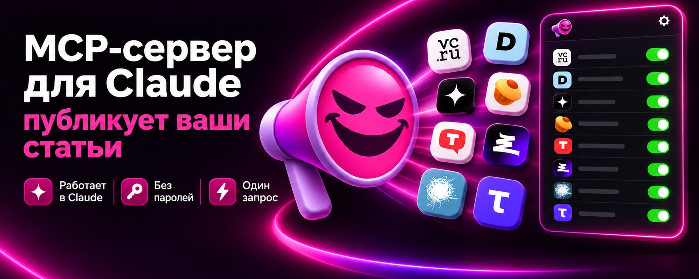
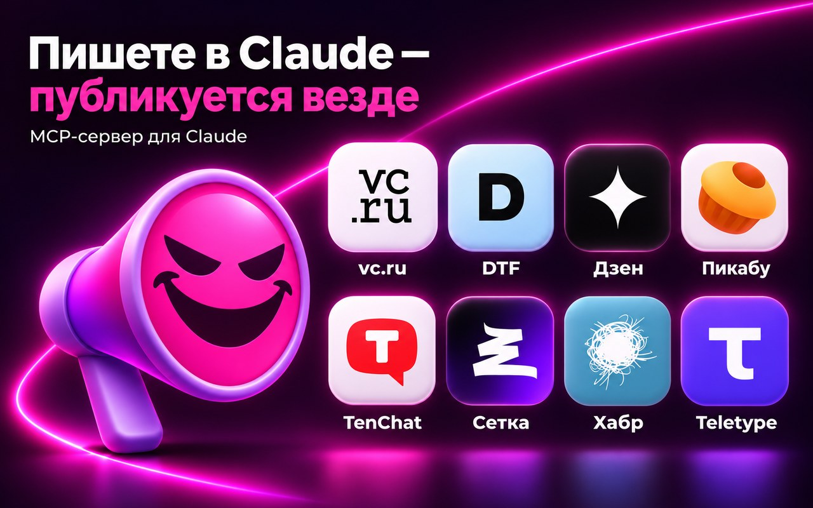
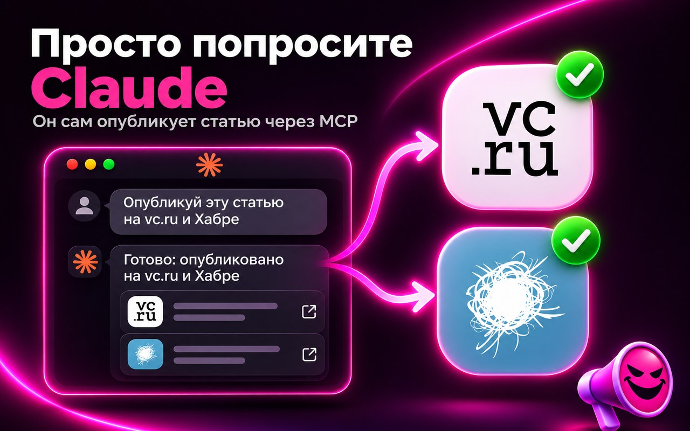
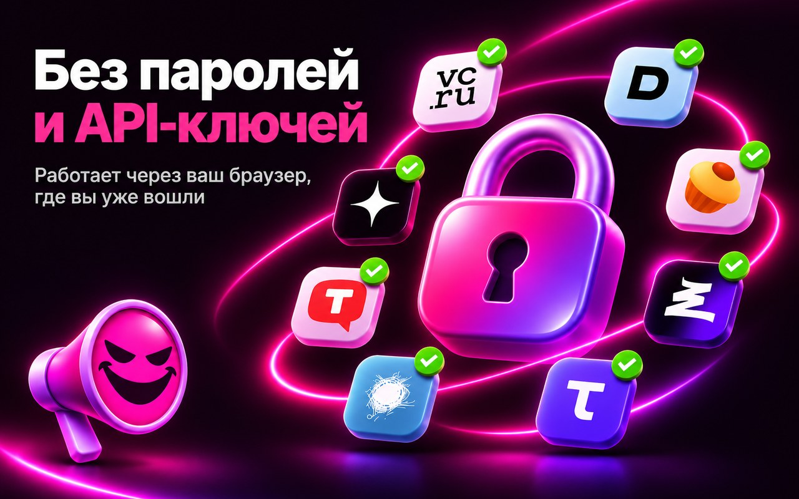

<p align="center">
  <a href="https://tentekposter.ru"></a>
</p>

<h1 align="center">Tentek Poster</h1>

<p align="center">
  <b>MCP-сервер для Claude: пишете в Claude — статья выходит на vc.ru, Хабре, Дзене и ещё пяти площадках.</b><br>
  Без паролей и API-ключей: публикует через ваш браузер, где вы уже вошли.
</p>

<p align="center">
  <a href="https://tentekposter.ru"><b>Сайт</b></a> ·
  <a href="https://github.com/kaicex/tentek-poster-releases/releases/latest/download/tentek-poster.mcpb"><b>Скачать для Claude Desktop</b></a> ·
  <a href="https://www.npmjs.com/package/tentek-poster">npm</a> ·
  <a href="https://t.me/kaicex">Поддержка в Telegram</a>
</p>

<p align="center">
  <a href="https://github.com/kaicex/tentek-poster-releases/releases/latest"></a>
  <a href="https://www.npmjs.com/package/tentek-poster"></a>
  
</p>

---

## Зачем

Статья готова, а дальше — по очереди открыть каждую площадку, вставить текст, заново оформить заголовки,
картинки и теги. Восемь площадок — восемь одинаковых ручных публикаций.

С Tentek Poster вы просто пишете Claude: **«Опубликуй эту статью на vc.ru и Хабре»**. Claude создаёт
черновики, оформляет текст по правилам каждой площадки и публикует — в ваших собственных аккаунтах.

<p align="center">
  
  
</p>

## Площадки

| | | | |
|---|---|---|---|
| **vc.ru** | **DTF** | **Дзен** | **Пикабу** |
| **TenChat** | **Сетка** | **Хабр** | **Teletype** |

<p align="center">
  
  
</p>

## Как это работает

```
Claude  ──MCP──▶  сервер Tentek Poster (на вашем компьютере)  ──▶  расширение в браузере  ──▶  vc.ru, Хабр, Дзен…
```

- **Сервер** работает локально и даёт Claude инструменты: создать черновик, поправить, опубликовать, удалить.
- **Расширение** для Chrome и Яндекс Браузера отправляет запросы из вашего браузера, где вы уже вошли на сайты.
  Пароли, cookie и токены никуда не передаются.
- **Вы управляете**: публикация идёт только по вашей команде, любую площадку можно выключить в окне расширения.

## Установка

**1. Подключите сервер к Claude**

- **Claude Desktop** — скачайте [tentek-poster.mcpb](https://github.com/kaicex/tentek-poster-releases/releases/latest/download/tentek-poster.mcpb)
  и откройте файл двойным кликом. Claude Desktop установит сервер сам.
- **Claude Code** — выполните в терминале:

  ```bash
  claude mcp add --scope user tentek-poster -- npx -y tentek-poster
  ```

  и перезапустите Claude Code.

**2. Поставьте расширение Tentek Poster** в Chrome или Яндекс Браузер и войдите на площадки, где хотите публиковать.
В окне расширения у каждой площадки виден ваш аккаунт.

**3. Попросите Claude** — например, «Опубликуй эту статью на vc.ru и Хабре» или «Поправь заголовок в черновике на Дзене».

Подробная инструкция — на [tentekposter.ru](https://tentekposter.ru).

<p align="center">
  
</p>

## Частые вопросы

**Нужен ли пароль или API-ключ?**
Нет. Запросы идут из вашего браузера, где вы уже вошли на площадку.

**Опубликует ли Claude что-то без меня?**
Нет. Только по вашей команде. Площадку можно выключить — тогда Claude её не видит.

**Куда уходят мои тексты?**
Напрямую на сами площадки. Сервер работает на вашем компьютере.

**Это работает только с Claude?**
С любым клиентом MCP. Проверено на Claude Desktop и Claude Code.

## Об этом репозитории

Здесь лежат готовые файлы для установки (`.mcpb` для Claude Desktop). История версий — во вкладке
[Releases](https://github.com/kaicex/tentek-poster-releases/releases).

---

<sub>Tentek Poster — независимый проект. Он не связан с vc.ru, DTF, Дзеном, Пикабу, TenChat, Сеткой, Хабром, Teletype
и Anthropic и не является их официальным продуктом. Публикует только в ваши собственные аккаунты и только по вашей команде.</sub>

<details>
<summary>English</summary>

**Tentek Poster** is an MCP server for Claude that publishes your articles to Russian-language platforms —
vc.ru, DTF, Dzen, Pikabu, TenChat, Setka, Habr and Teletype — straight from a chat with Claude.
It works through your own browser session via a Chrome extension: no passwords or API keys.

Install for Claude Desktop: download [tentek-poster.mcpb](https://github.com/kaicex/tentek-poster-releases/releases/latest/download/tentek-poster.mcpb) and double-click it.
For Claude Code: `claude mcp add --scope user tentek-poster -- npx -y tentek-poster`.
More at [tentekposter.ru](https://tentekposter.ru).
</details>
